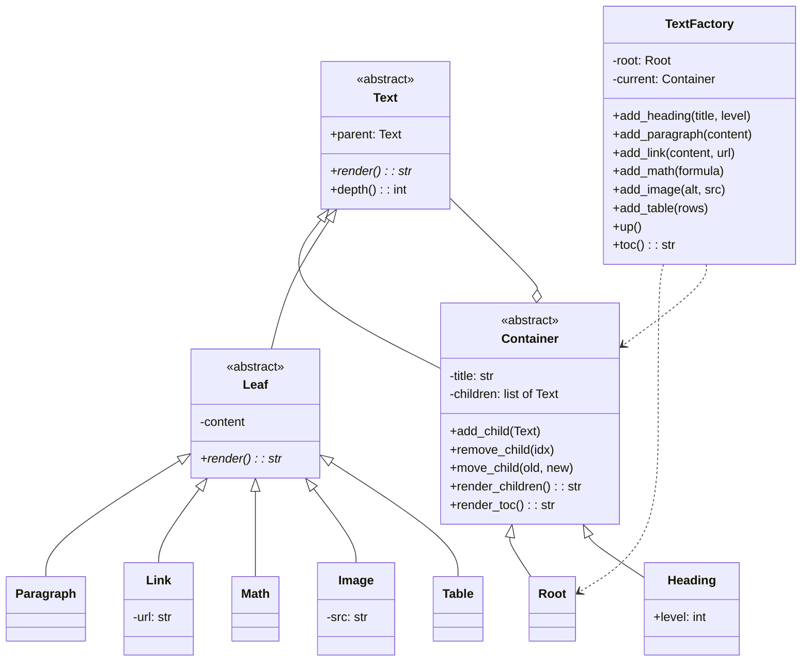

# Практична 3. Наслідування та поліморфізм

Система структурованого тексту з першої практичної, переписана під абстракцію, наслідування та поліморфізм.
Запуск: `python3 main.py`

## Діаграма класів

## Чому саме така структура

Текст статті — це дерево, а в дереві є лише два види вузлів: ті, що мають дітей (контейнери), і ті, що їх не мають (листки).
Тому ієрархія має три рівні.

- **Text** — кореневий абстрактний клас. Він задає єдиний контракт: будь-який елемент уміє `render()` і знає свого `parent`.
  Інстанціювати його не можна (`ABC` + `@abstractmethod`), бо в нього немає змісту без конкретного типу.
  Увесь решта коду працює з `Text` і не цікавиться, що саме перед ним.
- **Container** — абстрактний клас для вузлів з дітьми. Тримає `children`, вміє додавати, видаляти та переміщати дітей
  (методи з першої практичної перенесені сюди з колишнього класу `Text`), будує зміст `render_toc()`.
  Дітьми є `Text`, а не конкретні класи, тому контейнер може містити і листки, і інші контейнери.
- **Leaf** — абстрактний клас для кінцевих елементів. Тримає `content` і не має дітей.
- **Root, Heading** — конкретні контейнери. `Root` — корінь статті, `Heading` — заголовок із рівнем, що містить вкладений вміст.
- **Paragraph, Link, Math, Image, Table** — конкретні листки. Додати новий тип (наприклад, `Code`) — це один новий клас
  з `render()`, решту системи міняти не треба.

### Поліморфізм

`Heading.render()` викликає `render()` у кожної дитини, не перевіряючи її тип. Дитиною може бути параграф,
таблиця або інший заголовок — кожен відрендериться по-своєму. Раніше це робилося через окремий клас `Text`
зі списком `TextElement`, тепер дерево будь-якої вкладеності обробляється одним рекурсивним викликом.

### Абстракція

Користувач працює з типом `Text` і методом `render()`. Як саме елемент перетворюється на рядок
(markdown-заголовок, таблиця, формула) — деталі конкретного класу.

### TextFactory

Клас-фабрика ховає створення дерева. Він тримає `_root` і `_current` (контейнер, у який зараз додається вміст):

- `add_heading` створює заголовок, додає його в поточний контейнер і заходить в нього;
- `add_paragraph`, `add_link`, `add_math`, `add_image`, `add_table` додають листок у поточний контейнер;
- `up()` повертається на рівень вище;
- рівень заголовка за замовчуванням рахується сам за глибиною (`depth()`), тому не треба вручну вести нумерацію.

Усі методи повертають `self`, тому можна писати ланцюжком. Якщо згодом знадобиться вивід в html чи latex,
міняється лише `render()` у класах елементів, а код, що будує документ через фабрику, залишається тим самим.
